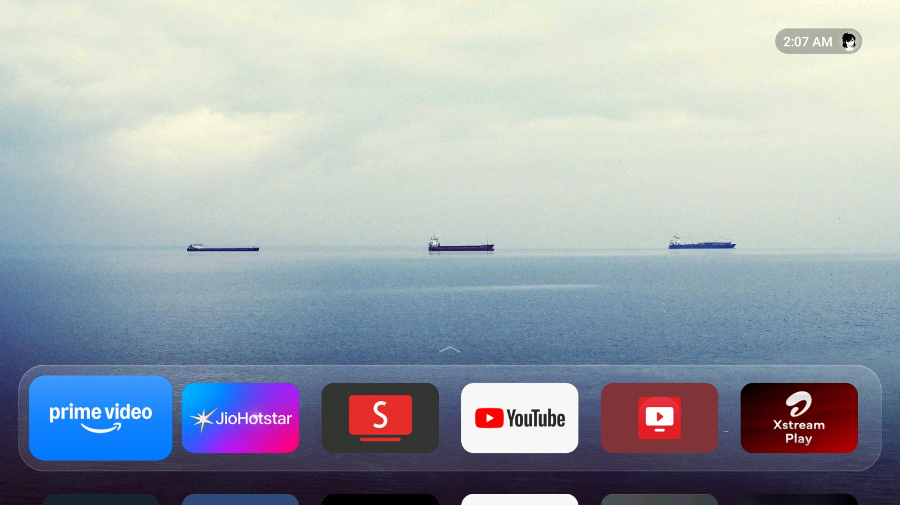
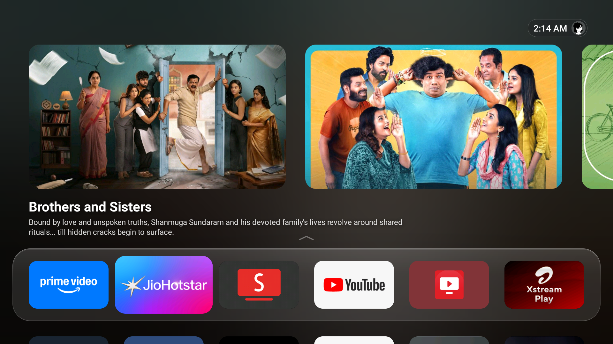
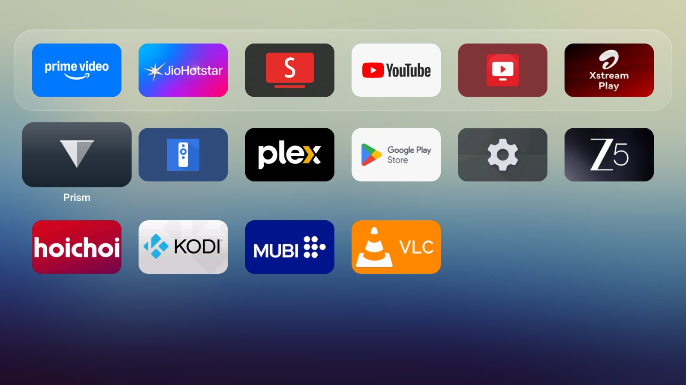
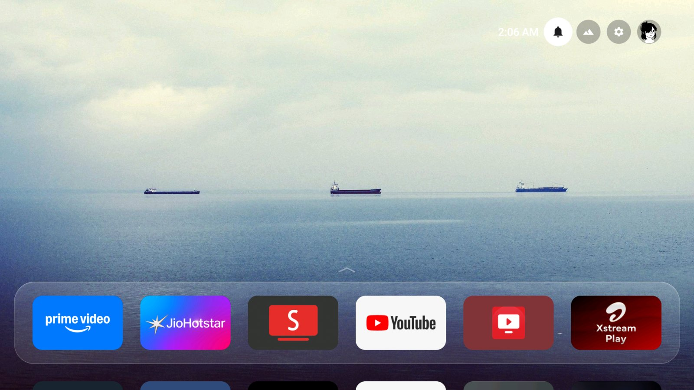
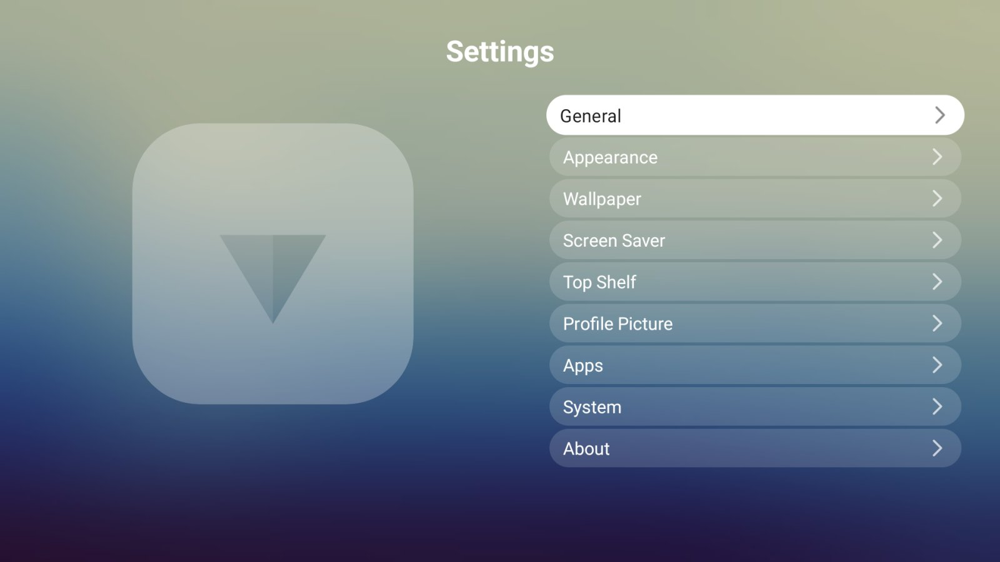
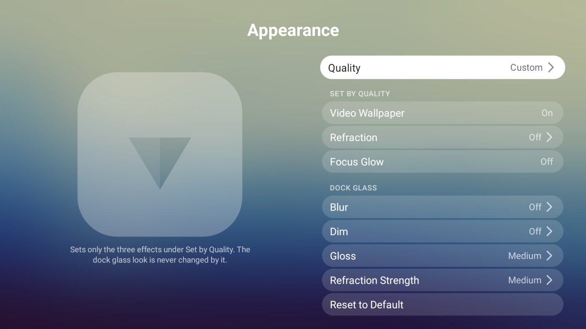
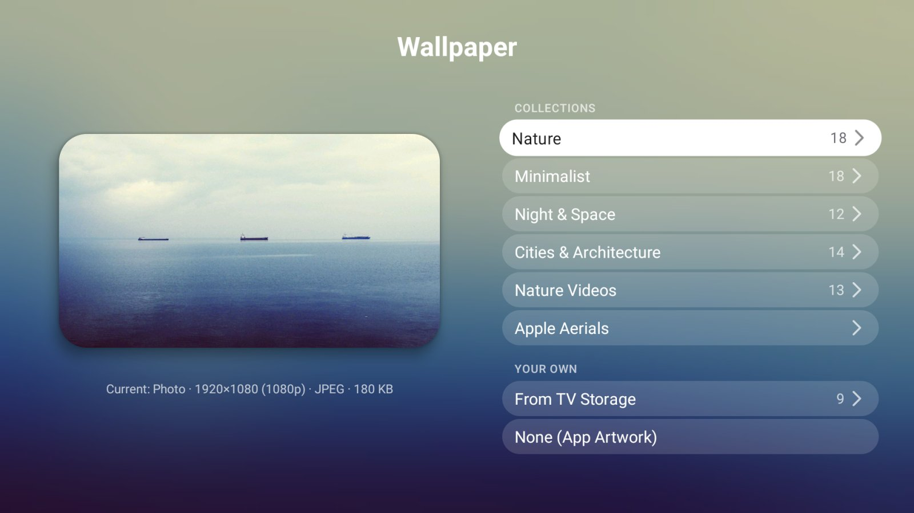
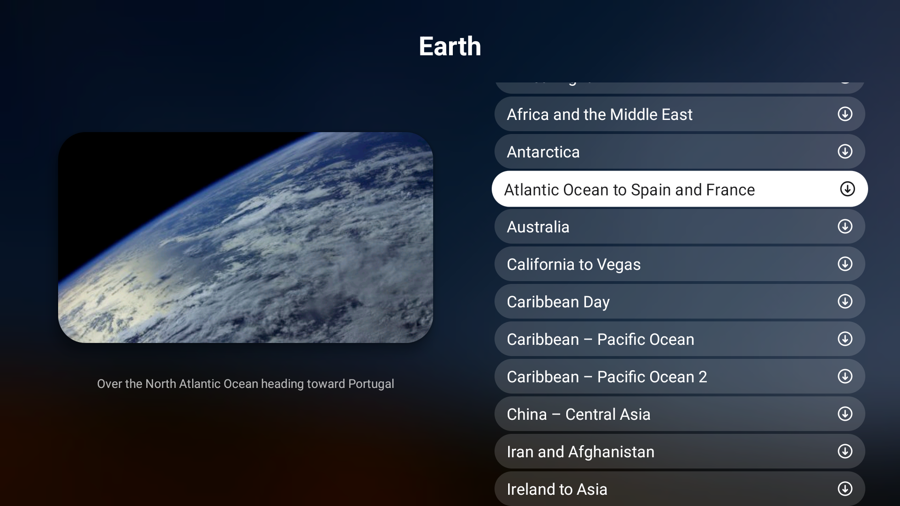
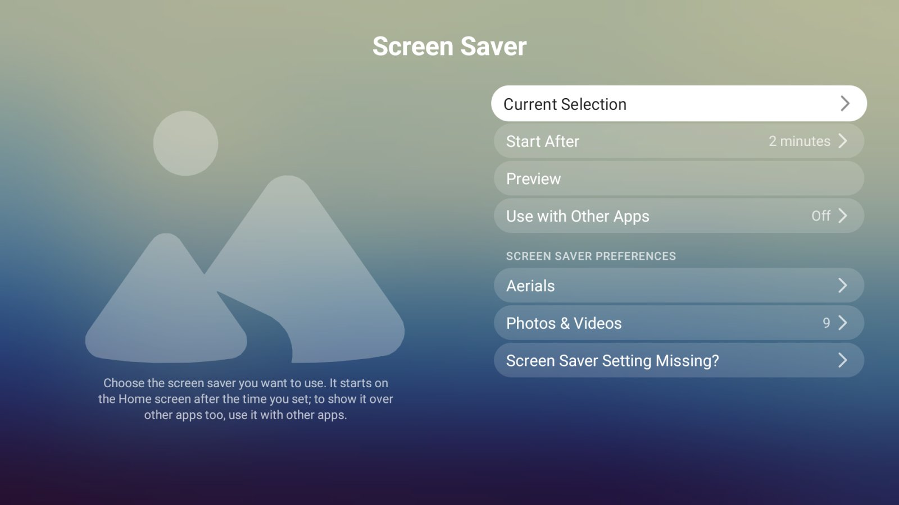
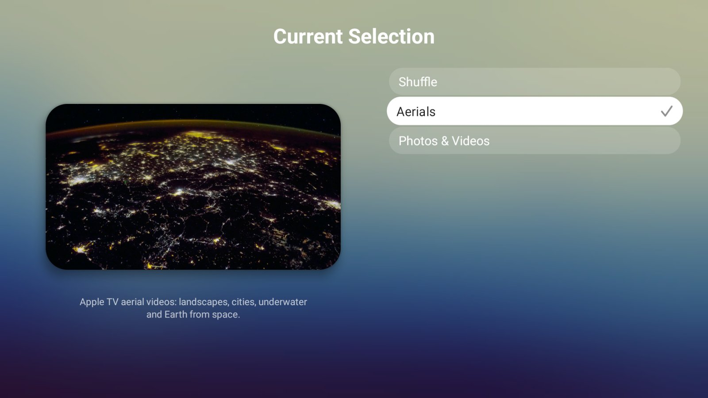

# Prism

A lightweight Android TV launcher inspired by the tvOS look: a glass dock, a Top Shelf that previews what your apps are playing, aerial screen savers and wallpapers. Built to run smoothly on modest TVs.



## Screenshots



| | |
|---|---|
|  |  |
| App grid | Notifications, screen saver, settings and profile |
|  |  |
| Settings | Appearance: quality presets and dock glass |
|  |  |
| Wallpaper collections | Aerial wallpapers |
|  |  |
| Screen saver | Current selection |

## Features

- **Glass dock and app grid** with focus animations measured from tvOS.
- **Top Shelf** showing the focused app's channel previews.
- **Wallpapers:** photo collections (Nature, Minimalist, Night & Space, Cities), short public-domain video loops, aerials, or your own photos and videos.
- **Screen saver:** aerials, your photos and videos, or shuffle between them.
- **Quality presets** (Low / Medium / High / Custom) that trade effects for memory on weaker TVs.
- **Check for Updates** from GitHub releases.
- No accounts, no ads, no tracking, nothing running in the background.

## Install

1. Download the APK from [Releases](https://github.com/akhil838/prism/releases) and install it on the TV.
2. Open Prism and follow the setup to make it the Home app.
3. If the Home button still opens the old launcher, run once from a computer with ADB:

   ```
   adb shell pm disable-user --user 0 com.google.android.tvlauncher
   ```

## Build

```
./gradlew :app:assembleRelease   # release
./gradlew :app:assembleDev       # release + diagnostic tools
```

## License

Apache License 2.0, see [LICENSE](LICENSE). Third-party credits are in [NOTICE](NOTICE).

Prism is an independent project and is not affiliated with Apple Inc.
